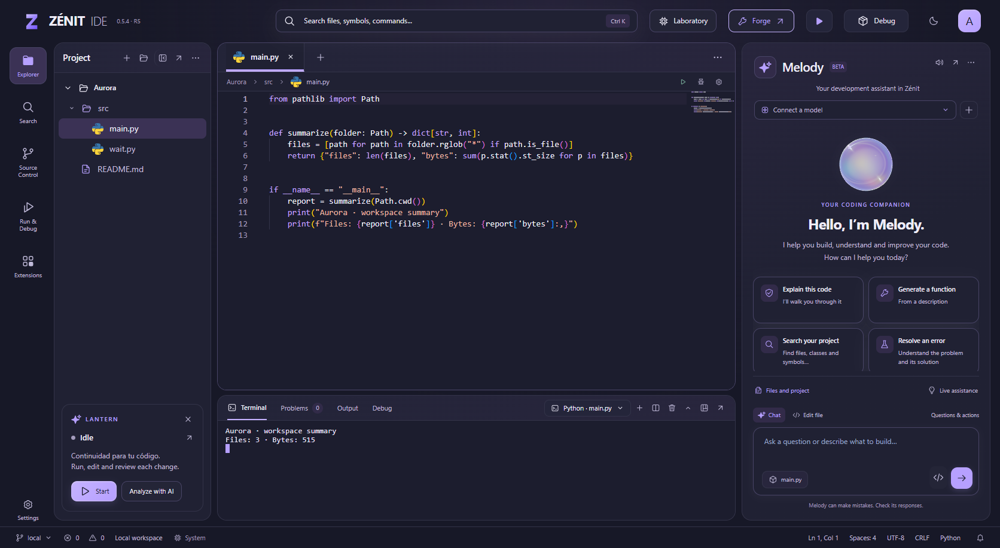
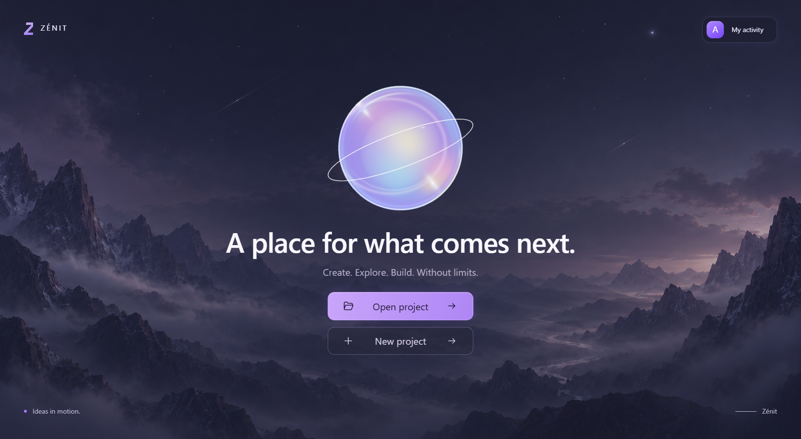
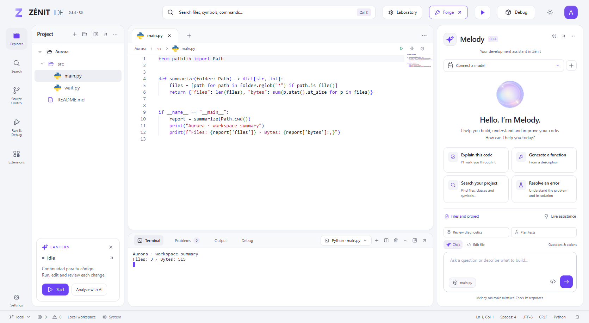
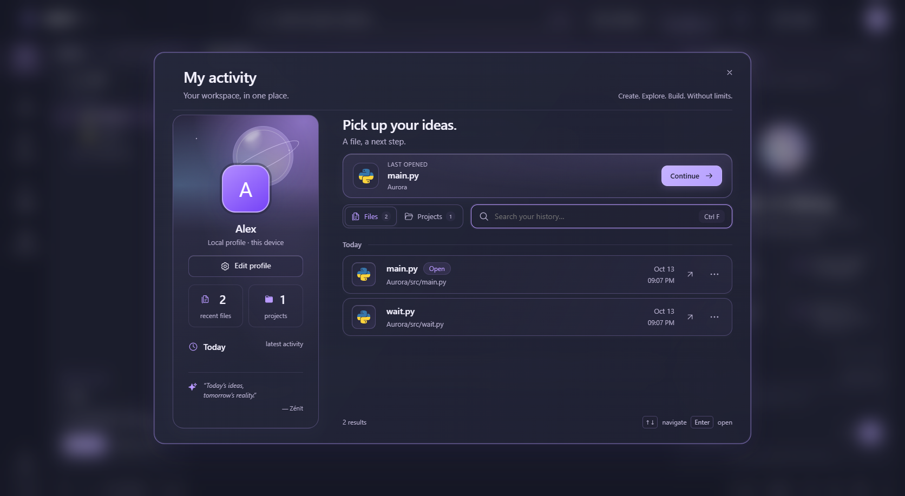
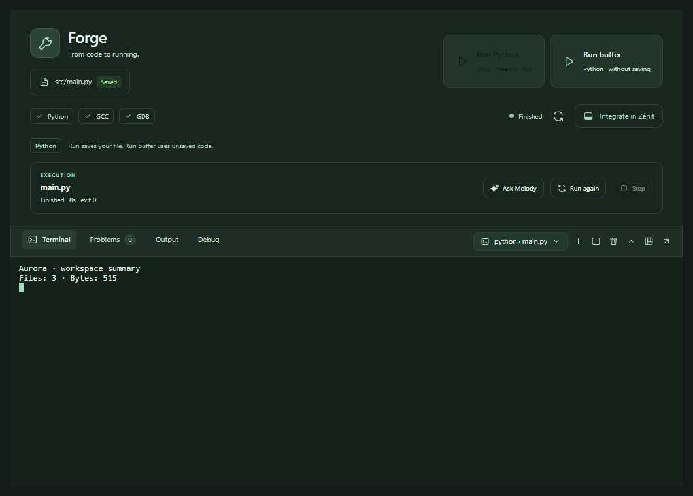

<div align="center">


# Zénit

### A calmer place to build.

**Code, execution and AI assistance in one desktop workspace — even across windows.**

[](LICENSE)
[](https://github.com/Arizt00/Zenit/releases/tag/v0.5.4-preview.7)
[](https://github.com/Arizt00/Zenit/releases/download/v0.5.4-preview.7/Zenit-0.5.4-R7-Windows-Setup.exe)

[**Download Zénit**](https://github.com/Arizt00/Zenit/releases/tag/v0.5.4-preview.7) · [Getting started](docs/GETTING_STARTED.md) · [Contribute](CONTRIBUTING.md) · [Discuss](https://github.com/Arizt00/Zenit/discussions)

[Read the launch article on DEV Community](https://dev.to/aristote_motehernndez/zenit-a-desktop-workspace-for-code-ai-assistance-and-real-execution-1np8)

</div>



Zénit brings the edit → run → inspect workflow into a single place. Keep Monaco,
your project, interactive terminals and Melody together; move an editor or panel
onto another monitor when you need space. Shared buffers keep unsaved work in
sync between the main application and its detached windows.

This is an actively developed **public preview**, not a claim of full VS Code
compatibility. Windows is the verified binary target for this release. See the
[release notes](docs/PREVIEW_054_R7.md) and [current boundaries](docs/STATUS.md).

R7 adds a paged binary inspector, original nC identity, recoverable editor tabs,
five local Melody evidence tools, and actual DAP memory/disassembly with pause
comparison. See the [R7 screenshot gallery](docs/media/r7/README.md).

## What makes it useful

| A daily problem | How Zénit helps |
| --- | --- |
| Code and execution drift across windows | Detached editors share buffers, saves and appearance; their terminal can sit below the code or return to the main window. |
| AI requests lack a clear scope | Melody shows the selected model and context. Choose a selection, the whole file, or no code for a question. |
| A snippet replaces too much | Review a selected range before applying; the rest of the file stays intact and the edit can be undone. |
| Running code requires switching tools | Forge prepares the configured runtime, starts an interactive terminal, and shows elapsed time and exit code. |
| A project is difficult to navigate | Search with case, whole-word, include/exclude, folder and file-type filters; open an exact matching location. |
| Tooling should fit your workspace | Light, dark and forest palettes, file icon themes, docking, split editors and native detached panels. |

## Install in a few steps

**Windows 10/11 x64** with Microsoft Edge WebView2:

1. Download the [Windows installer](https://github.com/Arizt00/Zenit/releases/download/v0.5.4-preview.7/Zenit-0.5.4-R7-Windows-Setup.exe), or the [portable ZIP](https://github.com/Arizt00/Zenit/releases/download/v0.5.4-preview.7/Zenit-0.5.4-R7-Windows-Portable.zip).
2. Run the installer, then open **Zénit**. For the portable version, extract the entire ZIP and run `Zenit/zenit.exe`.
3. Choose **Open project**, select a folder, open a source file and use **Run** or **Forge**.

The application includes its own Python runtime. Project compilers, language SDKs
and AI models are separate: configure them under **Settings → Languages and tools**
and **Settings → Artificial intelligence**. Provider accounts, availability and
charges depend on the chosen integration. Emma voice requires a compatible local
voice bridge; a hosted model or voice is not bundled.

Preview executables are currently unsigned. Release assets include SHA-256
checksums and a build manifest. Download from the linked GitHub release; see
[the installation guide](docs/GETTING_STARTED.md) for verification and platform details.

## Try a complete workflow

Create `hello.py`:

```python
def greet(name: str) -> str:
    return f"Hello, {name}!"

print(greet("Zénit"))
```

Open **Forge**, click **Run Python**, and inspect the real output. **Run again**
repeats that file; **Stop** ends its running process. **Run buffer** is the Python
action for executing unsaved editor content.

In Melody, connect a model and try:

```text
Explain this function and suggest a clearer name.
```

Select `greet`, choose **Selection or file**, and ask for a focused suggestion.
Review the selection before applying. For authorized workspace changes, name
the intended files explicitly:

```text
Create tests/test_greet.py with tests for greet, and update hello.py so importing
it does not print anything.
```

File plans provide review, recovery copies and undo. **Edit file** is a separate
mode for live changes to the active buffer. Automatic assistance and next-code
suggestions are available through **Live assistance**; generated advice still
needs your judgment.

## A workspace that moves with you



Start with a project, return through **My activity**, and keep your profile local.
The profile image becomes a faded cover behind your identity.

| Light workspace | Your activity |
| --- | --- |
|  |  |



These are screenshots of the running application and a small demo project.
Forge output is real. The gallery does not present a simulated AI answer as a
production result. [Capture details](docs/media/README.md).

## Useful shortcuts

| Shortcut | Action |
| --- | --- |
| `Ctrl+K` / `Ctrl+Shift+P` | Search / command palette |
| `Ctrl+Shift+F` | Project search |
| `Ctrl+S` | Save file |
| `Ctrl+\\` | Split editor |
| `Ctrl+J` | Toggle terminal |
| `F5` / `Shift+F5` | Run / stop the active task |
| `Ctrl+,` | Settings |

## Develop locally

```powershell
git clone https://github.com/Arizt00/Zenit.git
cd Zenit
python -m venv .venv
.venv/Scripts/python -m pip install -r requirements-build.txt
.venv/Scripts/python tools/setup_assets.py
.venv/Scripts/python app.py --desktop
```

For browser development, run `python app.py` and open the local URL printed by
the application. Native detached windows require the desktop runtime. Node.js
is needed for extension engines and JavaScript checks.

```powershell
python -m unittest discover -s tests -p "test_*.py"
npm run check
npm test
```

[Contributing](CONTRIBUTING.md) · [Architecture](docs/ARCHITECTURE.md) ·
[Feature status](docs/STATUS.md) · [R7 notes](docs/PREVIEW_054_R7.md)

## Build it with us

Try Zénit on a small project, share a reproducible issue, or improve one focused
workflow. Useful contributions include layout fixes at different DPI settings,
terminal behavior, accessibility, providers and extension compatibility.

[Report a bug](https://github.com/Arizt00/Zenit/issues/new?template=bug_report.yml) ·
[Suggest a feature](https://github.com/Arizt00/Zenit/issues/new?template=feature_request.yml) ·
[Ask a question](https://github.com/Arizt00/Zenit/discussions)

If Zénit helps your work, a star or a link shared with another developer helps
people discover it. The [roadmap](docs/ROADMAP.md) makes the next work visible.

## License

Zénit’s original code and documentation are **Apache-2.0**. See [LICENSE](LICENSE)
and [NOTICE](NOTICE). The independent `tools/asm_worker.py` retains **GPL-2.0-or-later**;
dependencies retain their own licenses: [third-party notices](THIRD_PARTY_NOTICES.md).
