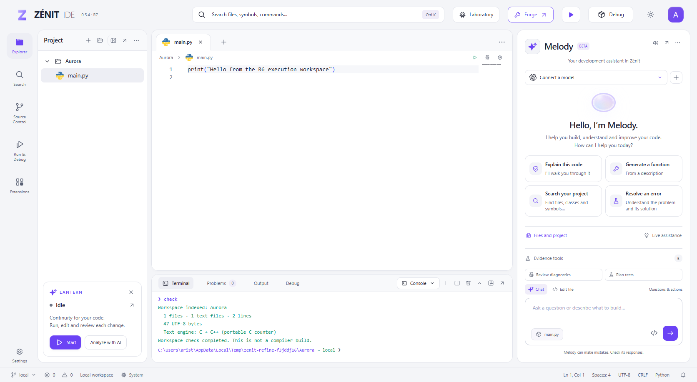
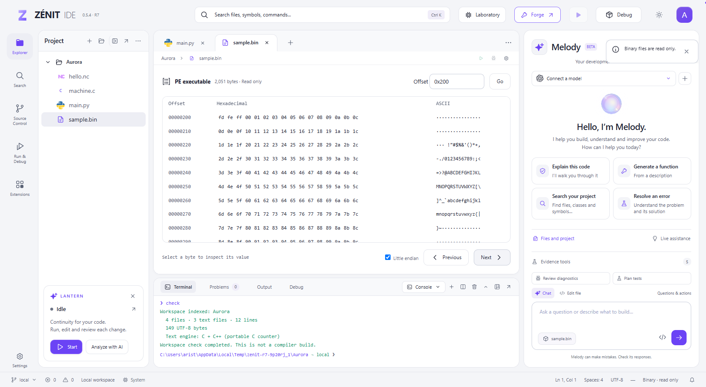
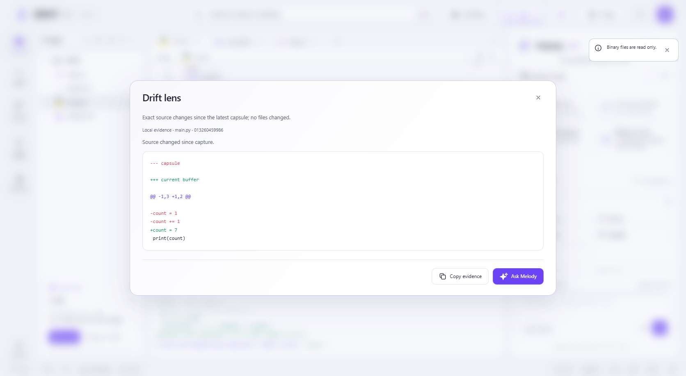
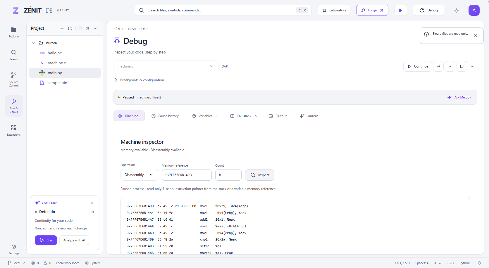
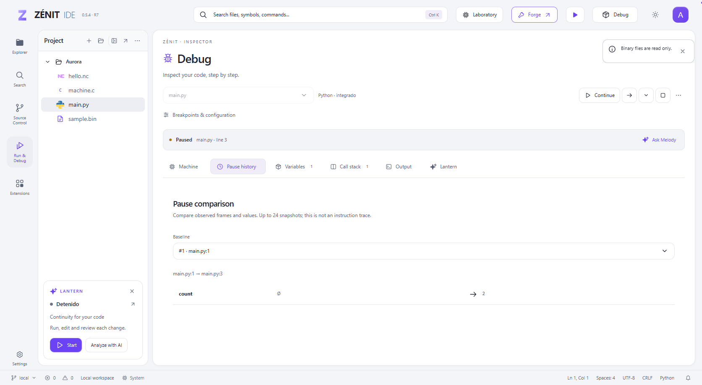
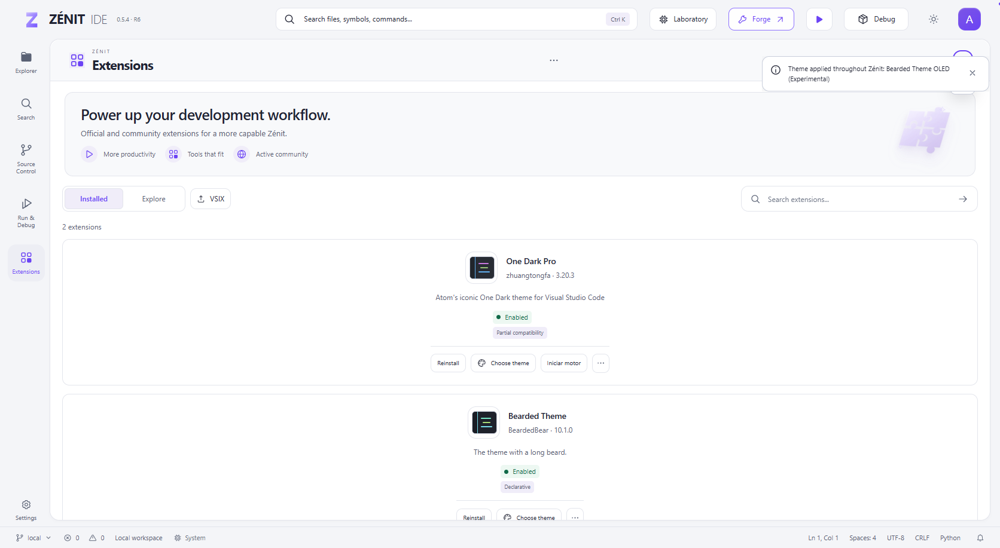
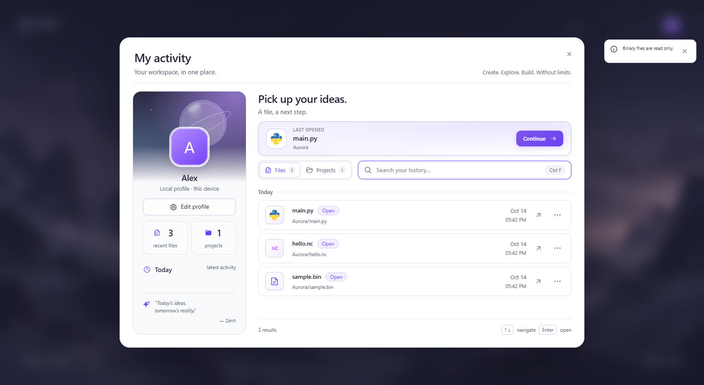
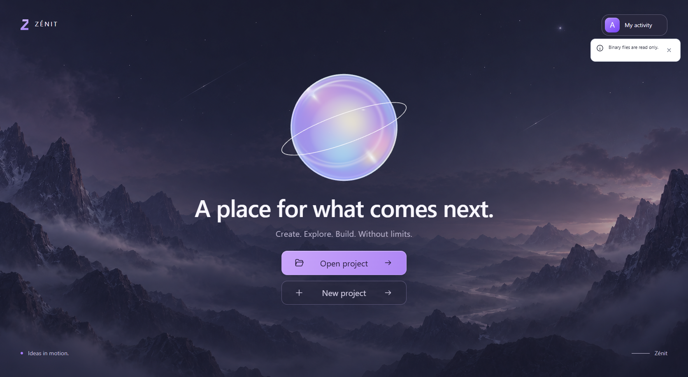
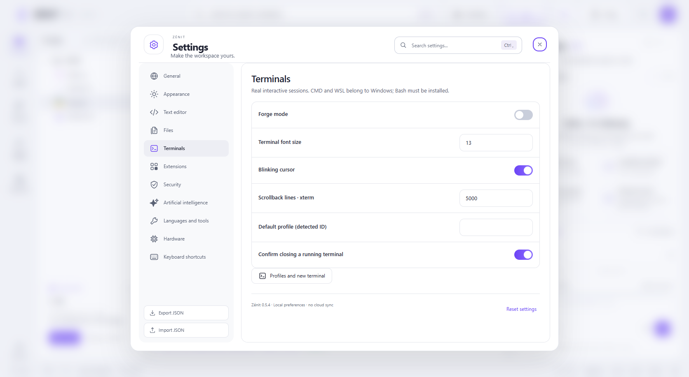

# R7 screenshot gallery

Captured on 14 October 2026 from the actual Zénit frontend in an isolated
Aurora/Alex profile. These are application screenshots, not mockups. Native
machine instructions and memory came from GCC/LLDB; pause history came from
Python. No AI response is included in this gallery. The tools shown calculate
local evidence before optional provider consultation. Hashes are in
[captures.json](captures.json).

Capture scripts: `tests/test_refine_r7_ui.py`, `tests/test_refine_r6_ui.py` and
`tests/test_r7_theme_ui.py`. Main viewport: 1672 × 917 CSS pixels. Public images
do not use the user's profile photo or live project.

| Workspace | Binary inspection |
| --- | --- |
|  |  |
| Melody evidence | Native machine inspection |
|  |  |
| Pause comparison | Extensions |
|  |  |
| Activity | Profile hover |
|  |  |
| Settings | |
|  | |
